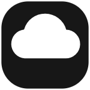
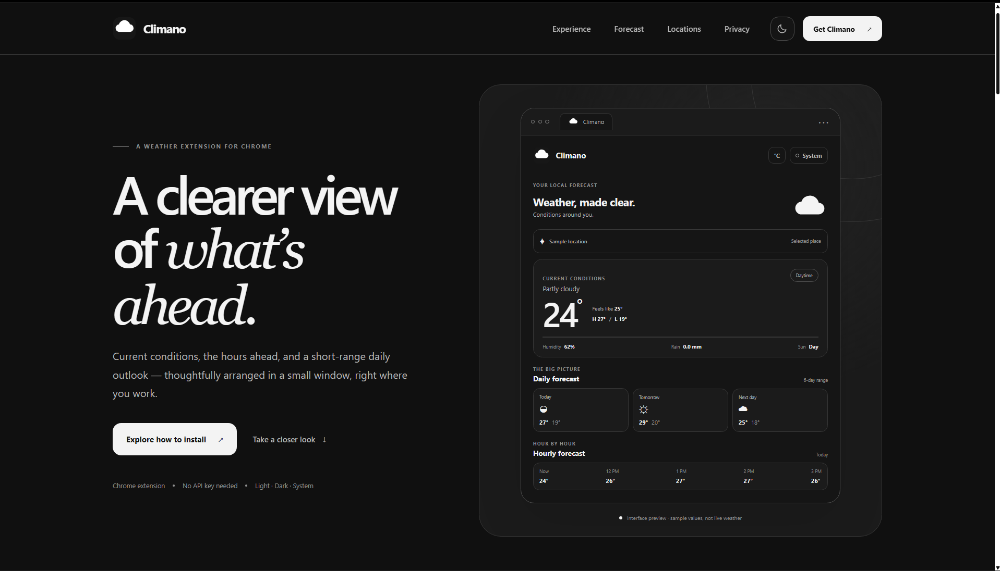

# Climano



Climano is a lightweight Chrome extension that brings local weather conditions and a detailed short-range forecast into your browser. It is built with Chrome Manifest V3 and a compact, monochrome interface designed to make weather information easy to scan.

> **License notice:** Climano is proprietary source-available software. You may inspect the public source and use official, unmodified releases for personal, non-commercial purposes only, subject to [`LICENSE.txt`](LICENSE.txt). Public source visibility does not grant general rights to copy, modify, redistribute, fork outside GitHub's platform functionality, or commercially use the Software.



## Features

- Current temperature, apparent temperature, weather condition, humidity, rain, and day/night state.
- Approximate location detection using the user's public IP through ipapi.co.
- Optional device geolocation when the user explicitly chooses **Use device location**.
- City and place search using the Open-Meteo Geocoding API.
- Daily high/low temperatures, weather conditions, sunrise, and sunset.
- Selectable hourly forecast with temperature and rain.
- Selected-hour details: apparent temperature, relative humidity, rain, visibility, low/mid/high cloud cover, sunshine duration, daylight state, wind speed at 180 m, and wind direction at 180 m.
- Celsius/Fahrenheit switching.
- System, light, and dark themes.
- Last location and forecast caching through Chrome local storage.

## How it works

1. On startup, Climano requests an approximate location from `https://ipapi.co/json/` unless a saved location is available.
2. The user can search for a city through the Open-Meteo Geocoding API or choose **Use device location** to request browser geolocation.
3. Climano sends the selected latitude and longitude to the Open-Meteo Forecast API.
4. The popup renders current conditions, daily forecast entries, hourly values, and the selected-hour details returned by the API.
5. Preferences and the last forecast are stored locally using `chrome.storage.local`.

### Forecast data requested

Climano requests these fields from Open-Meteo:

- **Current:** `temperature_2m`, `relative_humidity_2m`, `rain`, `is_day`, `apparent_temperature`, `weather_code`
- **Hourly:** `temperature_2m`, `relative_humidity_2m`, `apparent_temperature`, `rain`, `visibility`, `cloud_cover_low`, `cloud_cover_mid`, `cloud_cover_high`, `is_day`, `sunshine_duration`, `wind_direction_180m`, `wind_speed_180m`
- **Daily:** `sunrise`, `sunset`, `weather_code`, `temperature_2m_max`, `temperature_2m_min`
- **Range and timezone:** `past_days=3`, `forecast_days=3`, `timezone=auto`

The exact data displayed depends on the API response and availability for the selected location.

## Download and install in Chrome

Climano is **not currently published on the Chrome Web Store**. There is no Chrome Web Store installation link at this time.

### Download the source

Once the repository URL is published, clone it with:

```bash
git clone https://github.com/darshseraphic/Climano.git
```

Then open the cloned project directory.

### Load the extension in Chrome

1. Open Google Chrome.
2. Visit `chrome://extensions`.
3. Turn on **Developer mode**.
4. Click **Load unpacked**.
5. Select the cloned `climano-weather-extension` project folder (the folder containing `manifest.json`).
6. Pin Climano from Chrome's Extensions menu for convenient access.

No build step or weather API key is required for the current implementation.

## Project files

| File or directory | Purpose |
|---|---|
| `manifest.json` | Chrome Manifest V3 metadata, popup action, icons, permissions, and API host permissions. |
| `popup.html` | Popup structure, accessible labels, sections, and brand mark. |
| `popup.css` | Layout, monochrome design tokens, light/dark themes, responsive surfaces, and interaction states. |
| `popup.js` | Location lookup, city search, Open-Meteo requests, rendering, unit conversion, theme preferences, and local storage. |
| `assets/icons/icon16.png` | Small toolbar/extension icon. |
| `assets/icons/icon48.png` | Extension management icon. |
| `assets/icons/icon128.png` | Large extension icon. |
| `design.md` | Climano interface design direction and visual-system notes. |
| `README.md` | Project introduction, features, installation, behavior, and file guide. |
| `LICENSE.txt` | Proprietary source-available license governing Climano. |
| `CONTRIBUTING.md` | How to report issues and suggest improvements within the license terms. |
| `SECURITY.md` | Security, privacy, data-flow, and vulnerability-reporting information. |
| `CHANGELOG.md` | User-facing release history. |

## Privacy and permissions

- **IP lookup:** `ipapi.co` receives the public IP address as part of an IP-geolocation request. IP-based location is approximate.
- **Device location:** Chrome's `geolocation` permission is declared in the manifest because Chrome does not support it as an optional permission. Climano only calls the browser geolocation API after the user selects **Use device location**. Chrome may show a location permission warning when installing or updating the extension.
- **Forecast requests:** latitude and longitude are sent to Open-Meteo to retrieve weather data.
- **City search:** the entered place name is sent to the Open-Meteo Geocoding API.
- **Local storage:** preferences, last selected location, and cached forecast data are stored using `chrome.storage.local`.
- **No first-party analytics:** this project does not implement its own analytics or application server.

See [`SECURITY.md`](SECURITY.md) for more detail.

## Third-party services and attribution

- Weather and geocoding: [Open-Meteo](https://open-meteo.com/). Review its current terms and attribution requirements before public/commercial distribution.
- IP geolocation: [ipapi](https://ipapi.co/). Review its current service terms and privacy policy.
- Design reference attribution: Unslop by Damir Sokolovsky, [CC BY 4.0](https://creativecommons.org/licenses/by/4.0/). See `design.md` for attribution details.

Third-party names and services remain the property of their respective owners and are not part of the Climano brand. Their terms apply independently; see the third-party notices above and Section 5 of `LICENSE.txt`.

## Contributing

Please read [`CONTRIBUTING.md`](CONTRIBUTING.md) before submitting feedback or proposing changes. The proprietary license does not grant general permission to modify or distribute the source code; code contributions require prior written permission from the copyright holder.

## License

Climano is distributed under the terms in [`LICENSE.txt`](LICENSE.txt). All rights are reserved except for the limited permissions expressly granted there.
